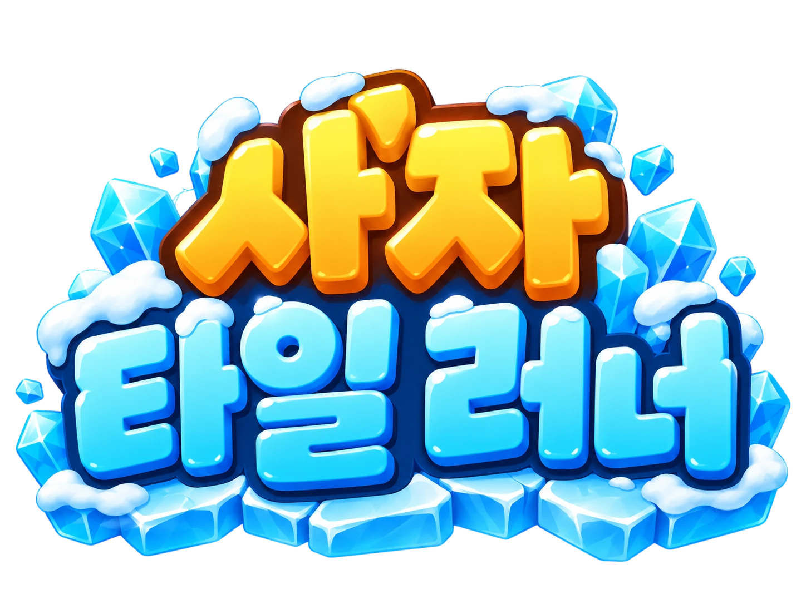
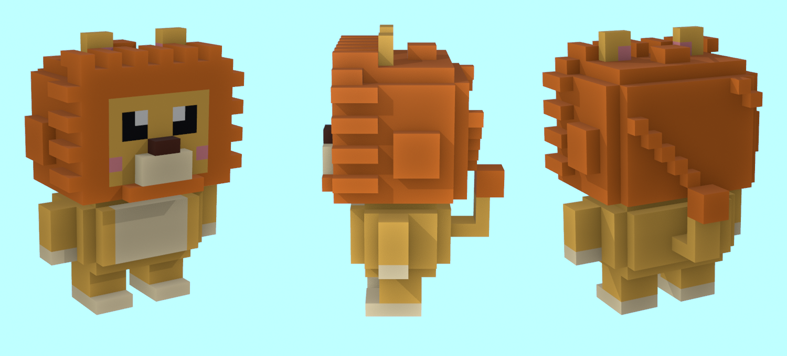
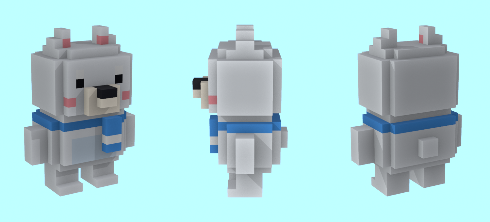
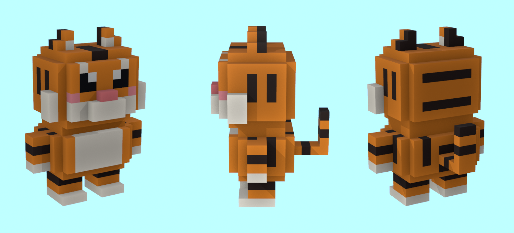
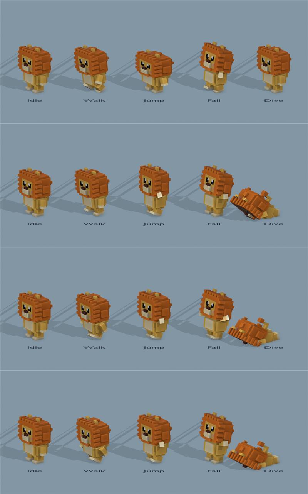
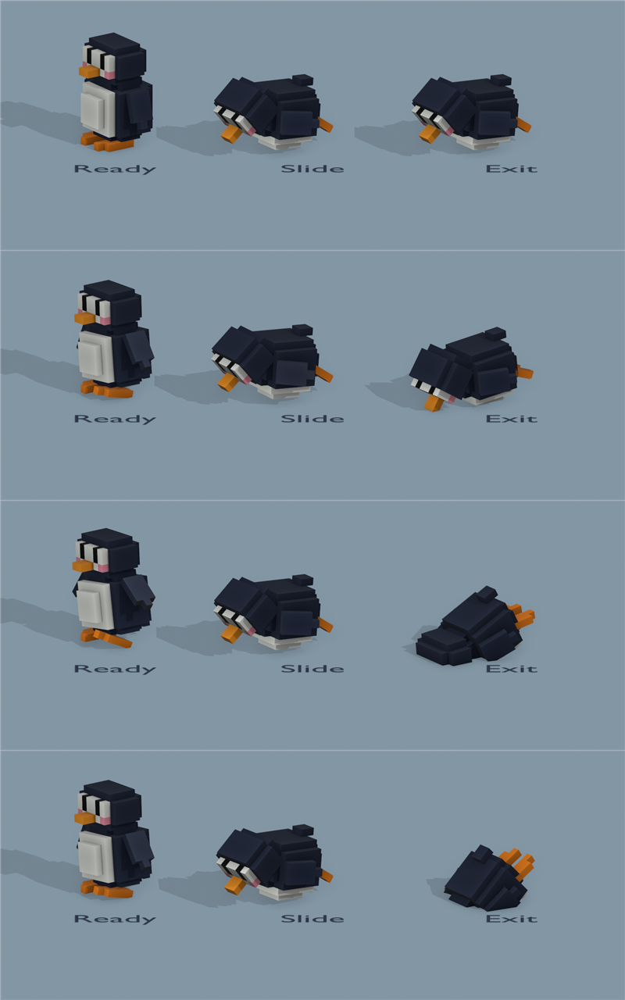

<div align="center">



### 🧊 녹아내리는 얼음판 위, 누가 가장 오래 버틸까? 🦁

폴가이즈 **Thin Ice**에서 영감을 받은 솔로 3D 서바이벌 게임<br>
복셀 동물이 되어 깨지는 얼음 위를 뛰고, 날고, 버티세요!


</div>

---

## 🎮 게임 소개

> 밟은 얼음은 깨지고, 바다에 떨어지면 끝.<br>
> **버틴 시간이 곧 기록**입니다. 최고 기록은 PC에 저장됩니다.

- 🧊 **6×6 얼음판** — 밟을 때마다 `살짝 금 → 많이 금 → 흔들림 → 깨짐`
- 🤖 **AI 봇 3마리** — 맵을 돌아다니며 여러분 주변 얼음을 깨뜨립니다
- ❄️ **점점 늘어나는 시련** — 버틸수록 눈덩이·찬바람·고드름·펭귄이 차례로 등장
- 💎 **파워업 아이템** — 얼음 복구, 방패, 슈퍼 점프, 얼음 굳히기
- 🎨 **Fall Guys 스타일** — 밝은 파스텔 톤, 말랑하게 튀는 움직임, 기울어진 굵은 UI

## 🕹️ 조작법

| 키 | 동작 |
|:---:|---|
| `W` `A` `S` `D` / 방향키 | 이동 |
| `Space` | 점프 (길게 누르면 높게, 짧게 누르면 낮게) |
| `Ctrl` / 게임패드 `X` | 다이브 — 점프 꼭대기에서 쓰면 가장 멀리! |
| `R` | 결과 화면에서 다시 하기 |

> 💡 **팁** — 깨진 칸 1개는 점프·다이브로 건널 수 있지만 2개는 못 건넙니다.<br>
> 밟는 횟수를 아끼는 것이 오래 버티는 비결!

## 🐾 캐릭터

능력은 모두 같고 겉모습만 다릅니다. 같은 뼈대를 써서 애니메이션을 공유합니다.

<div align="center">

| 🦁 사자 (기본) | 🐻‍❄️ 북극곰 | 🐯 호랑이 |
|:---:|:---:|:---:|
|  |  |  |
| 풍성한 갈기와 꼬리 | 파란 목도리 | 줄무늬 |

</div>

<details>
<summary><b>🎬 애니메이션 미리보기</b></summary>
<br>
<div align="center">

| 캐릭터 공통 클립 | 방해꾼 펭귄 클립 |
|:---:|:---:|
|  |  |
| Idle · Walk · Jump · Fall · Dive | Ready · Slide · Exit |

</div>
</details>

## ❄️ 시련

모든 시련은 **예고가 있어서 피할 수 있습니다.** 버틴 시간이 길어질수록 하나씩 추가됩니다.

| 시련 | 등장 | 효과 | 예고 |
|---|:---:|---|---|
| ⛄ **눈덩이 낙하** | 15초~ | 맞으면 2초 기절, 떨어진 칸 1단계 깨짐 | 커지는 그림자 |
| 🌬️ **찬바람** | 30초~ | 3초 동안 한 방향으로 밀어냄 | "찬바람! →" 안내 + 눈보라 |
| 🧊 **고드름** | 45초~ | 떨어진 칸 즉시 깨짐, 1초 기절 | 깜빡이는 붉은 원 |
| 🐧 **펭귄 슬라이딩** | 60초~ | 한 줄을 배로 미끄러지며 밀쳐냄 | 뒤뚱대는 펭귄 + 붉은 줄 표시 |

## 💎 파워업

| 아이템 | 효과 |
|---|---|
| 🩵 **얼음 복구** | 주변 3×3의 깨진 칸이 다시 얼어붙음 |
| 💜 **방패** | 시련에 한 번 맞는 것을 막아줌 |
| 💛 **슈퍼 점프** | 6초 동안 점프 1.6배 · 속도 1.25배 (깨진 칸 2개도 넘기 가능!) |
| 🤍 **얼음 굳히기** | 주변 5×5의 금 간 칸을 멀쩡하게 |

---

## 🛠️ 개발 정보

| 항목 | 내용 |
|---|---|
| 엔진 | Unity 6000.6.3f1 · Universal 3D (URP) |
| 입력 | 새 Input System |
| 모델링·애니메이션 | Blender 5.2 + Python 스크립트로 복셀 캐릭터 자동 생성 |
| UI | TextMeshPro + Fall Guys UI 스타일 |

<details>
<summary><b>📁 폴더 구조</b></summary>

```
UnityClassGame/
├── LionIceRun/                 # Unity 프로젝트
│   └── Assets/
│       ├── Scenes/Main.unity   # 메인 씬
│       ├── Scripts/            # 게임 코드 (Trials/ = 시련, Editor/ = 세팅 메뉴)
│       ├── Models/             # 캐릭터·펭귄 FBX
│       ├── Shaders/            # 바다 셰이더 등
│       └── UI/                 # 스프라이트·글꼴
├── Tools/
│   ├── blender/                # 복셀 캐릭터 생성 스크립트 (build_all.ps1)
│   ├── ui/                     # UI 시트 자르기 스크립트
│   └── docs/                   # blueprint 동기화 스크립트
├── UI/                         # UI 시트 원본, 타이틀 로고
└── blueprint.md                # 전체 계획과 진행 상황
```
</details>

<details>
<summary><b>▶️ 프로젝트 실행하기</b></summary>
<br>

1. Unity Hub에서 **Unity 6000.6.3f1**로 `LionIceRun/` 폴더를 엽니다.
2. `Assets/Scenes/Main.unity` 씬을 엽니다.
3. ▶ Play를 누르고 움직이면 게임이 시작됩니다!

새 씬에서 처음부터 세팅하려면 상단 메뉴 **LionIceRun**에서 순서대로 실행합니다.

1. Step 2 맵 세팅 → Step 2 바다 꾸미기
2. Step 3 플레이어 세팅
3. Step 4 얼음 깨짐 세팅 → Step 4 얼음 그래픽 세팅
4. Step 5 생존 시간 세팅 → Step 6 게임 매니저 세팅
5. Step 8 캐릭터 가져오기
6. AI 봇 세팅 → 시련·보상 세팅
7. Step 7 UI 세팅

캐릭터를 다시 만들려면:

```powershell
powershell -ExecutionPolicy Bypass -File Tools\blender\build_all.ps1
```
</details>

## 📋 진행 상황

| 영역 | 상태 |
|---|:---:|
| 맵 · 카메라 · 바다 | ✅ |
| 조작 (이동 · 가변 점프 · 다이브) | ✅ |
| 얼음 깨짐 + 그래픽 | ✅ |
| 캐릭터 스킨 3종 + 애니메이션 | ✅ |
| 생존 시간 · 최고 기록 · 게임 오버 | ✅ |
| AI 봇 | 🔧 테스트 중 |
| UI (Fall Guys 스타일) | 🔧 테스트 중 |
| 시련 4종 + 파워업 4종 | 🔧 테스트 중 |
| 효과음 · 빌드 · 타이틀/스킨 선택 화면 | ⏳ 예정 |

자세한 계획은 [blueprint.md](blueprint.md)에서 볼 수 있습니다.

---

<div align="center">

Made with 🦁 and ❄️ in Unity

</div>
